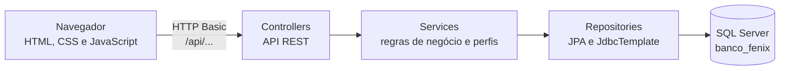
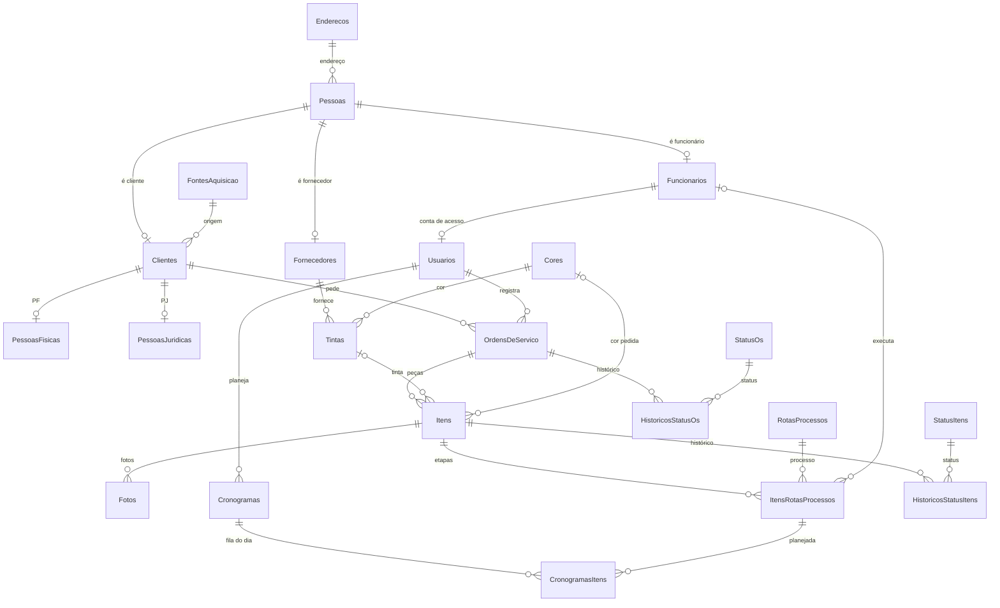

<p align="center">
  
</p>

<h1 align="center">Sistema Fênix</h1>

<p align="center">
  Gestão de ordens de serviço e produção para a Metalúrgica Fênix<br>
  Projeto de Extensão Comunitária · Informática para Negócios · Fatec Rio Preto · 2º semestre de 2026
</p>

<p align="center">
  <a href="#como-executar">Como executar</a> ·
  <a href="#funcionalidades">Funcionalidades</a> ·
  <a href="#perfis-de-acesso">Perfis de acesso</a> ·
  <a href="#banco-de-dados">Banco de dados</a> ·
  <a href="#testes">Testes</a> ·
  <a href="#equipe">Equipe</a>
</p>

---

## Sobre o projeto

A Metalúrgica Fênix é uma empresa familiar de São José do Rio Preto (SP) que faz pintura eletrostática a pó em peças
metálicas. O trabalho é organizado por ordens de serviço (OS): cada OS reúne as peças de um cliente, com a cor pedida,
a quantidade e o prazo, e cada peça passa por uma rota de produção (jateamento, banho e pintura).

O Sistema Fênix é o MPV (mínimo produto viável) de uma aplicação web para esse controle: cadastros, abertura da OS com
as peças, planejamento do dia, apontamento da produção, entrega e indicadores, entre eles o % de retrabalho usado no
ciclo PDCA do projeto.

Este repositório reúne duas etapas do Projeto de Extensão:

- **Etapa 2:** a aplicação web (back-end em Java com Spring Boot e front-end servido pela própria aplicação).
- **Etapa 3:** os recursos adicionais do banco de dados (4 functions, 3 views, 3 procedures, 3 triggers, backup e
  restore) e a integração deles com o sistema Java.

As etapas de qualidade (Etapa 1) e de estatística (Etapa 4) estão no relatório do grupo.

### Fluxo principal

1. Cadastrar o cliente e, se ainda não existirem, a cor, o fornecedor e a tinta.
2. Abrir a OS já com as peças. Cada peça leva descrição, quantidade, unidade, cor, tinta, prazo, valor e a rota de
   etapas.
3. Montar o cronograma do dia com as etapas a executar.
4. Na produção, apontar o início e a conclusão de cada etapa, com o operador. Uma etapa refeita fica registrada como
   retrabalho.
5. Registrar a entrega da peça.
6. Acompanhar tudo pelo dashboard e pelos relatórios.

O valor da OS e a data de finalização das peças são atualizados pelo próprio banco, pelos triggers da Etapa 3, que
também impedem alterar ou apagar o histórico de status.

## Funcionalidades

**Operação**

- **Dashboard:** indicadores (OS em aberto, OS concluídas, etapas produzidas hoje, % de retrabalho do mês, peças
  atrasadas e etapas no cronograma do dia), gráficos de produção diária, retrabalho por mês, produtividade por
  funcionário e OS por status, alertas e fila das próximas etapas.
- **Ordens de serviço:** abertura da OS com as peças (o número da nova OS aparece antes de salvar), lista com busca e
  filtros e detalhe com peças, valor, histórico de status e auditoria (linha do tempo completa da OS). Ações:
  alterar prioridade, pausar, retomar, concluir e cancelar.
- **Peças:** rota de produção, até 10 fotos por peça, pausa, retomada, cancelamento e registro da entrega.
- **Produção:** fila de etapas para iniciar e concluir, registro de retrabalho, indicador de retrabalho do PDCA e aba de
  produtividade.
- **Cronograma:** calendário do mês e fila planejada de cada dia, com sugestão automática da ordem da fila e
  replanejamento das etapas pendentes para outro dia.

**Cadastros**

- **Clientes** pessoa física ou jurídica, com validação de CPF e CNPJ, endereço preenchido pelo CEP (ViaCEP) e
  prioridade de 0 a 100 calculada pelo faturamento.
- **Funcionários**, com a aba **Usuários** para perfis e bloqueio de acesso (só administrador).
- **Fornecedores** de tinta.
- **Tintas**, com estoque em kg (entradas e baixas).
- Listas de apoio: cores, fontes de aquisição de clientes e etapas da rota.

**Gestão**

- **Relatórios:** Ordens de Serviço, Itens atrasados, Retrabalho, Clientes, Fornecedores, Estoque de tintas, Produção
  diária, Produtividade e Retrabalho mensal. Cada um tem prévia na tela e exportação em CSV, que abre no Excel.
- **Configurações** (só administrador): listas de apoio, parâmetros, resumo dos acessos e a aba **Banco de dados**, que
  mostra se os 13 objetos da Etapa 3 estão instalados, instala ou atualiza os objetos e faz backup e restore do banco.
- **Meu perfil:** e-mail, telefone, senha e pergunta de segurança.
- **Busca no topo** por OS (`12` ou `OS-12`), por peça (`#12`) ou por texto, e **sino de alertas** com peças
  atrasadas, OS pausadas e tintas sem estoque.

**Acesso**

- Login com usuário e senha. Senhas e respostas de segurança são gravadas com BCrypt.
- Depois de 5 senhas erradas seguidas, o login fica bloqueado por 15 minutos. A mensagem de erro é a mesma para login
  ou senha errados.
- **Cadastre-se:** o funcionário já cadastrado ativa a própria conta pelo CPF. Toda conta nova nasce com perfil
  Operador.
- **Lembrete de senha:** redefinição pela pergunta de segurança.

## Perfis de acesso

O sistema tem dois perfis: **Administrador** e **Operador**. A tela esconde o que o perfil não pode fazer, mas a
proteção de verdade está na API: cada método dos Services exige um perfil (`@PreAuthorize`). Se um operador chamar
uma rota de administrador, recebe **403** com a mensagem "Ação permitida só para administradores."

| Área | Administrador | Operador |
|---|---|---|
| Dashboard, Produção, Cronograma e Relatórios | tudo | tudo |
| Ordens de serviço | tudo, inclusive **cancelar** a OS | tudo, menos cancelar |
| Peças | tudo, inclusive **corrigir as datas** de uma etapa | tudo, menos corrigir datas |
| Clientes | cadastra, altera, **exclui** e **corrige CPF/CNPJ** | cadastra e altera |
| Funcionários | cadastra, altera, desliga e exclui; vê o salário; aba Usuários | só consulta, sem salário |
| Fornecedores | cadastra, altera, **inativa/reativa**, **exclui** e corrige CNPJ | cadastra e altera |
| Tintas | cadastra, altera, ajusta estoque e **exclui** | cadastra, altera e ajusta estoque |
| Configurações (listas, parâmetros, acessos e banco de dados) | tudo | sem acesso |
| Meu perfil | e-mail, telefone, senha e pergunta | igual |

O salário do funcionário nem sai da API quando quem pede é um operador.

## Tecnologias

| Camada | Tecnologia |
|---|---|
| Back-end | Java 25, Spring Boot 3.5.16 (Web, Data JPA e Security), Lombok |
| Banco de dados | Microsoft SQL Server (driver `mssql-jdbc`); H2 em memória nos testes |
| Front-end | HTML, CSS e JavaScript em módulos ES, sem etapa de build; Chart.js 4.5.1, fonte Inter e ícones Lucide, servidos pela própria aplicação |
| Testes | JUnit 5, Spring Boot Test e Spring Security Test |
| Build | Maven 3.9.16 pelo Maven Wrapper (`mvnw`), empacotamento WAR |
| Serviço externo | ViaCEP, chamado pelo navegador para preencher o endereço |

## Arquitetura



- Uma única aplicação Spring Boot serve o front-end (pasta `static`) e a API REST em `/api`, na mesma origem.
- O login é HTTP Basic, sem sessão no servidor: o navegador envia as credenciais a cada requisição. Na API, só as
  rotas de ativação de conta, pergunta de segurança e redefinição de senha dispensam login. Os arquivos do front-end
  são públicos, mas nenhum dado sai sem login.
- As regras de negócio ficam nos Services, com o perfil exigido em cada método.
- As entidades JPA são conferidas com o banco ao iniciar (`ddl-auto=validate`). A aplicação não cria nem altera
  tabelas: quem cria é o `schema.sql`.
- As functions, views e procedures da Etapa 3 são chamadas pelos repositories (`RotinasBancoRepository` e
  `ProcedimentosBancoSqlServer`). Os triggers agem sozinhos dentro do SQL Server.
- Os erros voltam em JSON padronizado (`ErroResponse`), com as mensagens das regras em português. Os erros levantados
  pelas procedures e pelos triggers (códigos 5xxxx) também são traduzidos para mensagens de regra de negócio.
- Ao iniciar, a aplicação confere se os 13 objetos da Etapa 3 estão instalados e escreve o resultado no log.
- O visual segue o protótipo feito no Lovable, adaptado ao que o banco e as regras de negócio realmente têm.

## Estrutura do repositório

```text
projeto-extensao-2026-2/
├── docs/
│   ├── database/             scripts do SQL Server (tabelas, carga, Etapa 3, backup) e LEIA_ME_BD.md
│   ├── telas/                capturas das telas feitas na Etapa 2
│   ├── front-end.md          guia do front-end: telas, rotas da API e perfis
│   └── regras_negocio_services_controllers.md
├── src/main/java/br/fatec/projetoextensao/
│   ├── config/               parâmetros do sistema (chaves fenix.* do application.properties)
│   ├── controllers/          API REST (/api/...)
│   ├── dtos/                 dados de entrada e saída da API
│   ├── entities/             entidades JPA, uma para cada uma das 22 tabelas
│   ├── enums/                status da OS e da peça; catálogo dos 13 objetos da Etapa 3
│   ├── exceptions/           tratamento de erros e tradução dos erros do SQL Server
│   ├── repositories/         Spring Data JPA e chamadas às functions, views e procedures
│   ├── security/             Spring Security: login, perfis e limite de tentativas
│   ├── services/             regras de negócio
│   └── validacao/            CPF, CNPJ, imagens, textos e valores
├── src/main/resources/
│   ├── static/               front-end (páginas HTML, css/, js/, img/ e vendor/)
│   └── application.properties
├── src/test/                 testes JUnit e scripts do banco H2 de teste
├── pom.xml
└── mvnw, mvnw.cmd            Maven Wrapper
```

## Banco de dados

O banco se chama `banco_fenix`, no SQL Server, e tem 22 tabelas. Os scripts ficam em [`docs/database`](docs/database):

| Ordem | Script | O que faz |
|:-:|---|---|
| 1 | `schema.sql` | cria o banco `banco_fenix` e as 22 tabelas, com chaves e restrições |
| 2 | `data.sql` | carga de demonstração: 15 clientes, 8 funcionários com acesso, 4 fornecedores, 21 tintas e 12 OS com 20 peças, além de etapas, cronogramas e históricos |
| 3 | `objetos_banco.sql` | os 13 objetos programáveis em um só script, nesta ordem: 4 functions, 3 views, 3 procedures e 3 triggers |
| — | `backup_restore.sql` | backup completo com verificação do arquivo e restore; também é usado pela tela Configurações > Banco de dados |

A ordem dentro do `objetos_banco.sql` importa, porque views, procedures e triggers usam a função `dbo.fn_valor_os`.
O script usa `create or alter`: rodar de novo atualiza os objetos sem apagar dados.

### Os 13 objetos da Etapa 3

| Objeto | O que faz | Onde o sistema usa |
|---|---|---|
| `fn_valor_os`<br><sub>function escalar</sub> | valor líquido da OS: soma das peças não canceladas | conferência do valor gravado pelos triggers |
| `fn_itens_atrasados`<br><sub>function de tabela</sub> | peças com prazo vencido e não encerradas, com dias de atraso, próxima etapa e operador | dashboard, sino de alertas e relatório Itens atrasados |
| `fn_prioridade_clientes`<br><sub>function de tabela</sub> | prioridade de cada cliente (0 a 100), proporcional ao faturamento das OS não canceladas | tela Clientes e prioridade inicial da OS |
| `fn_auditoria_timeline_os`<br><sub>function de tabela</sub> | linha do tempo da OS: status da OS, status das peças e início e conclusão das etapas | aba Auditoria da OS |
| `vw_painel_ordens_servico`<br><sub>view</sub> | painel das OS: cliente, status atual e contagem das peças (executadas, canceladas, atrasadas...) | listas de OS, dashboard, Clientes e relatórios |
| `vw_produtividade_funcionario`<br><sub>view</sub> | etapas concluídas por dia, funcionário e processo, com retrabalho e minutos trabalhados | gráficos de produção, aba Produtividade e relatórios |
| `vw_retrabalho_mensal`<br><sub>view</sub> | indicador mensal do PDCA: peças executadas, peças com retrabalho e % de retrabalho | gráfico e indicador do mês, relatório Retrabalho mensal |
| `sp_ajustar_estoque_tinta`<br><sub>procedure</sub> | entrada ou baixa de estoque da tinta, com a linha travada e saldo nunca negativo | ajuste de estoque na tela Tintas |
| `sp_cancelar_ordem_servico`<br><sub>procedure</sub> | cancelamento da OS em cascata: peças abertas, cronogramas futuros, status e valor | botão Cancelar OS |
| `sp_replanejar_cronograma`<br><sub>procedure</sub> | copia as etapas não concluídas de um dia para o cronograma de outro dia | botão Replanejar pendências |
| `trg_itens_sincronizar_valor_os`<br><sub>trigger</sub> | confere a cor da peça com a cor da tinta e recalcula o valor da OS a cada mudança nas peças | automático ao gravar uma peça |
| `trg_historicos_status_os_proteger`<br><sub>trigger</sub> | o histórico de status da OS só recebe inclusões, e OS encerrada não recebe novo status | automático ao gravar status da OS |
| `trg_historicos_status_itens_sincronizar_item_e_os`<br><sub>trigger</sub> | o histórico da peça só recebe inclusões; preenche a data de finalização e recalcula o valor da OS | automático ao gravar status da peça |

A explicação completa de cada objeto, a integração com o Java, um roteiro de demonstração no SSMS e a rotina de
backup e restore estão em [`docs/database/LEIA_ME_BD.md`](docs/database/LEIA_ME_BD.md).

<details>
<summary><strong>Diagrama das tabelas</strong></summary>



Uma pessoa é cliente, funcionário ou fornecedor (pode ser cliente e funcionário, ou cliente e fornecedor, mas nunca
funcionário e fornecedor). O cliente é pessoa física ou jurídica, nunca as duas. O status atual da OS e da peça é o
último registro do histórico.

</details>

## Como executar

### Pré-requisitos

- **JDK 25** (o `pom.xml` usa `java.version` 25).
- **SQL Server 2016 SP1 ou mais recente** (a edição Express ou Developer serve), com autenticação SQL Server
  habilitada e TCP/IP na porta 1433.
- **SQL Server Management Studio (SSMS)** ou outro cliente para rodar os scripts.
- **Git.** O Maven não precisa ser instalado: o projeto usa o Maven Wrapper.

### 1. Clonar o repositório

```bash
git clone https://github.com/CaioCavarzan/projeto-extensao-2026-2.git
cd projeto-extensao-2026-2
```

### 2. Criar o banco

No SSMS, abra e execute os scripts de `docs/database`, nesta ordem:

1. `schema.sql`
2. `data.sql`
3. `objetos_banco.sql`

O `schema.sql` cria o banco do zero. Se já existir um `banco_fenix`, apague-o antes (os dados dele serão perdidos).

O script do passo 3 também pode ser instalado pela própria aplicação, com o perfil Administrador, em
**Configurações > Banco de dados > Instalar ou atualizar objetos**.

### 3. Configurar a conexão

O endereço do banco, o usuário e a senha ficam em `src/main/resources/application.properties`:

```properties
spring.datasource.url=jdbc:sqlserver://localhost:1433;databaseName=banco_fenix;encrypt=true;trustServerCertificate=true;
spring.datasource.username=sa
spring.datasource.password=<sua senha>
```

Para não deixar a senha no Git, informe usuário e senha por variáveis de ambiente, que têm prioridade sobre o
`application.properties`. No PowerShell, antes de rodar a aplicação:

```powershell
$env:SPRING_DATASOURCE_USERNAME = "sa"
$env:SPRING_DATASOURCE_PASSWORD = "sua_senha"
```

As variáveis valem só para aquela janela do terminal. Se a instância do SQL Server for nomeada (por exemplo
`SQLEXPRESS`) ou usar outra porta, ajuste o `spring.datasource.url`.

### 4. Rodar a aplicação

```powershell
.\mvnw.cmd spring-boot:run
```

No Linux ou macOS, use `./mvnw spring-boot:run`. Também dá para rodar a classe `ProjetoextensaoApplication` pela IDE.

Abra **http://localhost:8080/**. Sem login, qualquer tela leva para a página de login. Com o banco completo, o log da
inicialização mostra `Objetos da Etapa 3 no banco: 13 de 13 instalados.`

### 5. Entrar

O `data.sql` cria 8 contas de demonstração, todas com a senha `Fenix@2026`. Elas só existem no banco criado por esse
script. Alguns exemplos:

| Perfil | Login |
|---|---|
| Administrador | `cardosopedrohenrique2006@gmail.com` (as contas dos quatro integrantes do grupo são de administrador) |
| Operador | `pintor01.fenix@gmail.com` |
| Operador | `jatista01.fenix@gmail.com` |

A carga registra 33 fotos de peças pelo nome do arquivo, mas os arquivos de imagem não estão no repositório. Numa
instalação nova, essas fotos não aparecem.

Num banco sem a carga de demonstração, o primeiro administrador é criado como está em
[`docs/front-end.md`](docs/front-end.md#2-primeiro-acesso-criar-o-primeiro-administrador): o funcionário é cadastrado
direto no banco, ativa a conta em **Cadastre-se** e é promovido a administrador por um `update`.

### Gerar o pacote

```powershell
.\mvnw.cmd clean package
```

O pacote sai em `target/projetoextensao-0.0.1-SNAPSHOT.war`. Ele roda com
`java -jar target/projetoextensao-0.0.1-SNAPSHOT.war` ou pode ser publicado num Tomcat externo, e nesse caso o
endereço passa a ter o nome do contexto (por exemplo `http://localhost:8080/projetoextensao/`). O `package` também
roda os testes; para pular, acrescente `"-DskipTests"`.

### Parâmetros

As regras configuráveis ficam em `application.properties`, nas chaves `fenix.*`:

| Chave | Para que serve (valor atual) |
|---|---|
| `fenix.prioridade.minima`<br>`fenix.prioridade.maxima` | escala da prioridade do cliente e da OS (0 a 100) |
| `fenix.itens.unidades` | unidades aceitas para a peça (PEÇA, CONJUNTO, KG, METRO e JOGO) |
| `fenix.login.max-tentativas`<br>`fenix.login.bloqueio-minutos` | senhas erradas seguidas antes do bloqueio (5) e duração do bloqueio em minutos (15) |
| `fenix.fotos.diretorio` | pasta dos arquivos das fotos (`fotos`), relativa à pasta de onde a aplicação é iniciada; o banco guarda só o nome do arquivo |
| `fenix.fotos.max-por-item`<br>`fenix.fotos.tamanho-maximo-mb` | fotos por peça (10) e tamanho máximo de cada uma em MB (10) |
| `fenix.fotos.lado-maximo-px`<br>`fenix.fotos.qualidade-jpg` | a foto é gravada em JPG com no máximo 1920 px no lado maior e qualidade 0.8 |
| `fenix.cors.origens` | origens liberadas no CORS (`http://localhost:5173` e `http://localhost:8080`); só importam se outro front-end chamar a API |

## Testes

```powershell
.\mvnw.cmd test
```

- São mais de 150 testes JUnit, que cobrem os Services, a API, a segurança, a validação de documentos e a integração
  com os objetos da Etapa 3.
- Os testes que precisam de banco rodam num H2 em memória (perfil `test`), criado a partir do script do grupo
  (`src/test/resources/schema-h2.sql`). O `etapa3-h2.sql` cria versões de teste das functions, views e triggers, e as
  procedures são imitadas em Java (`ProcedimentosBancoH2`).
- A exceção é o `ProjetoextensaoApplicationTests`, que sobe a aplicação com a configuração normal. Para ele passar, o
  SQL Server precisa estar ligado com o `banco_fenix` criado.

Há também um teste de integração com o SQL Server de verdade, desligado por padrão. Ele confere os 13 objetos
instalados, os códigos de erro das procedures e um fluxo de OS passando pelos triggers e pela procedure de
cancelamento. Precisa de um administrador ativo cadastrado e deve rodar de preferência numa cópia do banco:

```powershell
.\mvnw.cmd test "-Dtest=Etapa3SqlServerIT" "-Dfenix.it.sqlserver=true"
```

No PowerShell, as aspas evitam que os parâmetros `-D` com ponto sejam quebrados.

## Documentação complementar

- [`docs/front-end.md`](docs/front-end.md): telas, rotas da API, perfis e segurança no navegador.
- [`docs/regras_negocio_services_controllers.md`](docs/regras_negocio_services_controllers.md): levantamento das regras
  de negócio para os Services e Controllers.
- [`docs/database/LEIA_ME_BD.md`](docs/database/LEIA_ME_BD.md): os 13 objetos da Etapa 3, a integração com o Java, o
  roteiro de demonstração no SSMS e o backup e restore.
- [`docs/telas`](docs/telas): capturas das telas feitas na Etapa 2 (22/10/2026), antes da integração da Etapa 3.

<!-- VÍDEO: quando o link estiver pronto, cole-o na linha "Vídeo:" e apague esta linha e a linha final do bloco.
## Vídeo de demonstração

- Vídeo: https://
-->

## Equipe

Grupo **O Último a Sair Apaga o Maçarico**

- Caio Henrique Cavarzan
- Gustavo Henrique Vitor
- Marcio Mateus Gonçalves Filho
- Pedro Henrique Cardoso Dos Santos Marques

Componentes curriculares envolvidos no Projeto de Extensão: Administração de Banco de Dados, Linguagens de
Programação II, Estatística e Gestão da Qualidade e Ambiental.

Organização atendida: Metalúrgica Fênix, São José do Rio Preto (SP).

## Bibliotecas de terceiros

O front-end inclui, na pasta `src/main/resources/static/vendor`, cada uma com a sua licença:
[Chart.js](https://www.chartjs.org) (MIT), a fonte [Inter](https://github.com/rsms/inter) (SIL Open Font License 1.1) e os
ícones [Lucide](https://lucide.dev) (ISC).
