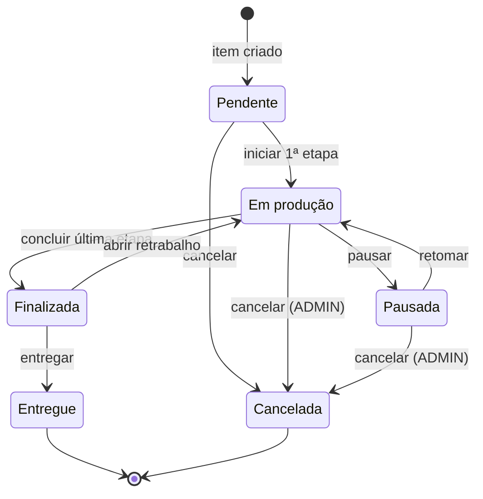
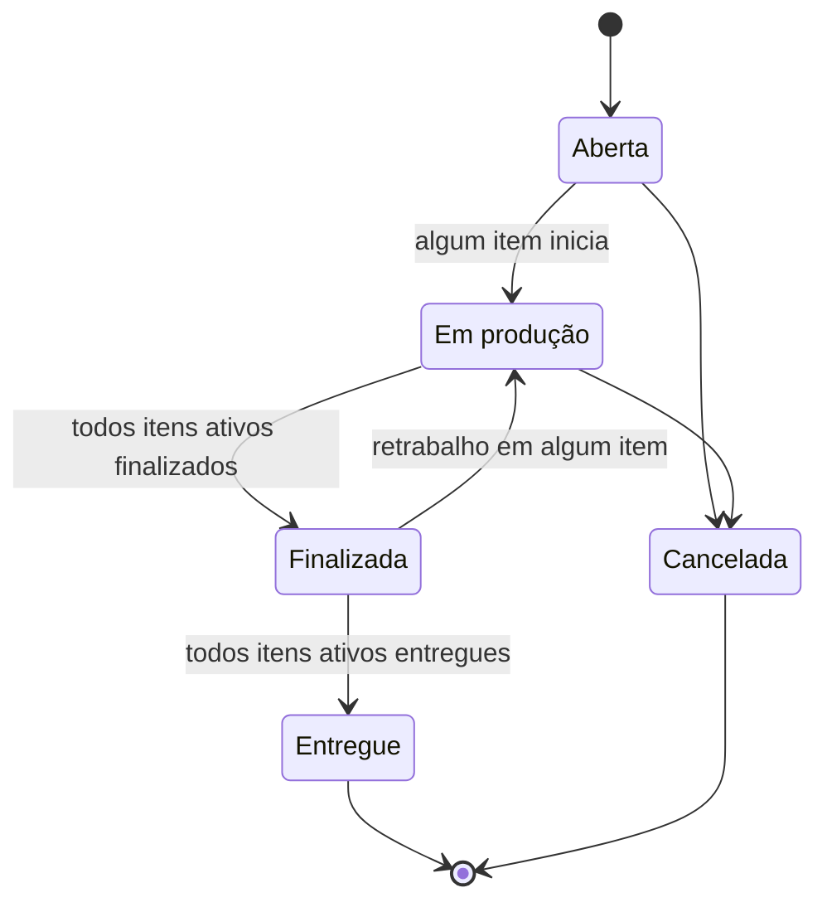

# Regras de Negócio — Services (e sugestões para Controllers)

Projeto: **projetoextensao** (Spring Boot 3.4.3, Java 21, JPA/Hibernate, SQL Server `banco_fenix`)
Domínio: gestão de serviços de **pintura eletrostática a pó** de peças metálicas.

---

## 0. Como ler este documento

### 0.1 Fontes e precedência

| Prioridade | Fonte | Uso |
|---|---|---|
| 1ª (primária) | Repositório: entidades, repositórios, `application.properties`, `docs/database/script_banco.sql` | Define **o que existe** e o que o banco já garante |
| 2ª (secundária) | Minimundo | Usado apenas onde o repositório é omisso; **quando conflita com o banco, vale o banco** |

### 0.2 Legenda das regras

Cada regra tem um identificador (`CLI-03`, `ITM-12`…) para ser referenciada em testes, commits e issues.

| Tag | Significado |
|---|---|
| **[BD]** | O banco já garante (constraint/FK/unique). A Service **deve validar antes** para devolver mensagem amigável em vez de uma `DataIntegrityViolationException` |
| **[SVC]** | Regra que só a Service pode garantir (o banco não cobre) |
| **[SUG]** | Sugestão minha, derivada do minimundo/bom senso do domínio. Precisa de validação do cliente/professor |
| **[DEC]** | Ponto em aberto — ver [seção 9](#9-decisões-pendentes) |

### 0.3 Restrição assumida

Conforme solicitado, **a estrutura atual do projeto é mantida** (entidades, repositórios, script do banco). Nada aqui exige alterar tabelas. Onde o minimundo pede algo que o banco não comporta, isso aparece como **lacuna** (seção 1.2) com alternativas, para você decidir.

---

## 1. Diagnóstico do estado atual

### 1.1 O que existe

- **Entidades (25):** hierarquia `Pessoa → Cliente (abstrata) → PessoaFisica | PessoaJuridica`, `Pessoa → Funcionario`, `Pessoa → Fornecedor` (herança `JOINED`); `Usuario` (1:1 com Funcionario); `OrdemServico`, `Item`, `Foto`, `Tinta`, `Cor`, `RotaProcesso`, `ItemRotaProcesso`, `Cronograma`, `CronogramaItem`, `StatusOs`, `StatusItem`, `HistoricoStatusOs`, `HistoricoStatusItem`, `Endereco`, `FonteAquisicao`.
- **Repositórios:** um `JpaRepository` por entidade, **todos vazios** (sem queries derivadas).
- **Services:** só `PessoaService`, com o repositório injetado e nenhum método.
- **Controllers / DTOs / exceptions / segurança:** inexistentes.
- **Dependências ausentes no `pom.xml`:** `spring-boot-starter-validation` (Bean Validation) e algo para hash de senha (`spring-security-crypto` ou `spring-boot-starter-security`).

### 1.2 Divergências entre minimundo e banco (o banco prevalece)

| # | Minimundo diz | Banco/código atual | Consequência para as Services |
|---|---|---|---|
| D1 | Cliente: foto, referência, 2+ telefones, 2+ e-mails | `Pessoas` tem **1 e-mail e 1 telefone** (opcionais); sem foto nem referência | Não exigir "2 ou mais". Não existe foto de cliente |
| D2 | Tipo de cliente (PF/PJ) | Implícito na herança (`PessoaFisica` / `PessoaJuridica`) | Service decide o tipo pela subclasse; tipo é **imutável** |
| D3 | Funcionário com cargo | `cargo` texto livre, + `salario`, `data_admissao`; existe `Usuario` (login/senha/admin) | Novo módulo de autenticação e perfis |
| D4 | OS com `status`, `observação`, "último funcionário que editou" e "última data/hora de modificação" | Sem coluna de status (usa `HistoricosStatusOs`), sem observação, **sem auditoria de edição** | Status = último registro do histórico. Auditoria é **lacuna [DEC-1]** |
| D5 | Item com processo, prioridade, urgência, status, cliente, data de produção | Item **não** guarda nada disso. Processo → `ItensRotasProcessos`; status → `HistoricosStatusItens`; cliente → via OS; prioridade/urgência → substituídas por `score_prioridade` | Estado do item é **derivado** |
| D6 | Número do item = nº da OS + letra | Item só tem `codigo` identity | Número "12A" é **calculado** (não persistido) — regra ITM-05 |
| D7 | Item pode ter várias tintas (N:N) | `Itens.tinta_codigo` (0..1) e `Itens.cor_codigo` | Um item tem no máximo **uma** tinta |
| D8 | Produção: entidade própria (código, data, funcionário, processo) | Representada por `ItensRotasProcessos` (etapa com `data_inicio`, `data_conclusao`, `funcionario_codigo`) | "Produção" = execução de uma **etapa** |
| D9 | **Retrabalho** (motivo, responsável, data) | **Não existe** tabela/entidade | **Lacuna [DEC-2]** |
| D10 | Cronograma ↔ item (N:N) com qtd, processo e funcionário | `Cronogramas` (cabeçalho: usuário, data, obs) + `CronogramasItens` ligando a **etapa** (`ItemRotaProcesso`) com `qtd_planejado`, `posicao`, `pontuacao` | Cronograma planeja **etapas**, não itens soltos. Funcionário designado vive na etapa |
| D11 | Tinta: código, rótulo, referência | `codigo` identity, `ref_fornecedor`, **`estoque_atual`**, `valor_unit`; sem rótulo | Existe controle de **estoque** que o minimundo não previa [DEC-4] |
| D12 | Processos: Jato, Pintura, Jato e Pintura, Reforma, Repintura | Tabela `RotasProcessos` (nome ≤ 25 chars) — dados cadastrais, sem seed no script | Precisa de carga inicial. "Jato e Pintura" pode virar 2 etapas [DEC-3] |
| D13 | Prioridade Alta/Média/Baixa e urgência | `Clientes.prioridade` (int), `OrdensDeServico.prioridade` (int), `Itens.score_prioridade` | Score calculado pela Service (seção 6) |

### 1.3 Pontos técnicos que impactam as Services

1. **Status por histórico, sem coluna "atual".** O status vigente = linha com maior `data_hora`. O PK do histórico é `(os|item, status, data_hora)` e o `@PrePersist` **trunca para segundos** → duas transições para o mesmo status no mesmo segundo geram **violação de PK**. A Service deve impedir transição repetida (HST-02) e garantir desempate (HST-03).
2. **Tabelas de status/rota/cor/fonte são dados, não enum.** O script não tem `INSERT`. Sem *seed*, nenhuma Service funciona. Recomendo `docs/database/seed.sql` (seção 8) e uma classe de constantes que mapeie nomes → regras.
3. **Sem `@Version` nem coluna de versão** → sem lock otimista. Estoque de tinta, transições de status e posição no cronograma sofrem *lost update*. Usar `@Lock(PESSOIMISTIC_WRITE)` nessas operações (CC-07).
4. **`@Data` do Lombok em entidades** com herança `JOINED` gera `equals/hashCode` que ignora a superclasse. **Nunca comparar entidades com `equals`; comparar por `codigo`.**
5. **`UsuarioEntity` expõe `senhaHash` e `respostaHash`.** Entidades **nunca** devem sair numa resposta HTTP → DTOs obrigatórios.
6. **`spring.jpa.open-in-view=true`** está ligado. Funciona, mas esconde `LazyInitializationException` e acesso ao banco na camada web. Services devem devolver DTOs/entidades já resolvidas; avaliar desligar depois.
7. **`ddl-auto=validate`**: qualquer ajuste de entidade precisa bater com o script.
8. **`ClienteEntity` é abstrata**: `ClienteRepository.save()` só funciona com instância de `PessoaFisicaEntity`/`PessoaJuridicaEntity`.
9. **`UsuarioEntity.isAdmin`** (campo `boolean isAdmin` + Lombok) gera `isAdmin()/setAdmin()`. Cuidado no mapeamento para DTO/JSON.

---

## 2. Arquitetura e convenções transversais (CC)

Estrutura sugerida — **apenas adiciona pacotes**, sem mexer nos existentes:

```
br.fatec.projetoextensao
├── entities/            (existente)
├── repositories/        (existente)
├── services/            (existente — implementar aqui)
├── controllers/         (novo)
├── dtos/                (novo: records de request/response)
├── exceptions/          (novo: exceções de negócio + @RestControllerAdvice)
├── validators/          (novo: CPF, CNPJ, CEP, UF, e-mail, telefone)
├── security/            (novo: login, filtro, usuário autenticado)
└── config/              (novo: Clock, constantes de score, CORS)
```

| ID | Regra |
|---|---|
| CC-01 | **Uma Service por agregado**, sempre `@Service` com injeção por **construtor** (preferir a `@Autowired` em campo, que é o estilo atual do `PessoaService`) |
| CC-02 | **Controllers não acessam Repositories.** Toda regra fica na Service |
| CC-03 | **Services não retornam nem recebem Entities no limite da API.** Entrada/saída por DTO (`record` do Java 21); o mapeamento Entity↔DTO fica na Service ou em um mapper |
| CC-04 | `@Transactional` na Service: leitura com `readOnly = true`; **escrita em operação composta** (ex.: criar OS + item + histórico) numa única transação com *rollback* para qualquer `RuntimeException` |
| CC-05 | Exceções de negócio próprias: `RecursoNaoEncontradoException` (404), `RegraNegocioException` (422), `ConflitoException` (409 — duplicidade/estado incompatível), `AcessoNegadoException` (403). Tradução centralizada em `@RestControllerAdvice` |
| CC-06 | **Relógio injetável** (`Clock` bean, fuso `America/Sao_Paulo`). Nunca chamar `LocalDateTime.now()` direto na Service — facilita testes de prazo/atraso |
| CC-07 | Operações sensíveis a concorrência (estoque, transição de status, posição no cronograma, geração de letra do item) usam **lock pessimista** na linha-pai |
| CC-08 | **Normalização antes de validar e persistir:** `trim`; CPF/CNPJ/CEP/telefone sem máscara (o banco exige só dígitos); CNPJ em maiúsculas; e-mail em minúsculas; UF em maiúsculas |
| CC-09 | **Exclusão física é exceção.** Registro com dependentes não é apagado; usa-se inativação (`ativo`) ou cancelamento. Lookups só podem ser apagados se **sem uso** |
| CC-10 | **Usuário logado vem do contexto de segurança**, nunca do corpo da requisição (campos `usuarioCadastrou` etc. são ignorados se enviados) |
| CC-11 | **Datas "de sistema" são definidas pela Service** (`data_entrada`, `data_hora` de histórico, `data_inicio`, `data_conclusao`, `data_finalizacao`). O cliente da API não as informa |
| CC-12 | **Dinheiro e quantidades** em `BigDecimal`, escala 2, `RoundingMode.HALF_UP`; comparar com `compareTo` (nunca `equals`) |
| CC-13 | Mensagens de erro em português, objetivas, sem vazar SQL/stacktrace |
| CC-14 | Listagens **paginadas** (`Pageable`), com filtros opcionais; nada de `findAll()` sem limite em tabelas operacionais (OS, Itens, Históricos) |

### 2.1 Perfis e permissões

O banco só distingue `is_admin`. Perfis sugeridos:

| Perfil | Origem | Pode |
|---|---|---|
| **ADMIN** | `Usuarios.is_admin = 1` e `ativo = 1` | Tudo, incluindo funcionários, usuários, salários, fornecedores, exclusões, reabertura/cancelamento de itens em produção |
| **OPERADOR** | `Usuarios.is_admin = 0` e `ativo = 1` | Clientes, OS, itens, produção, cronogramas, tintas (consulta), lookups (criar) |
| *(sem login)* | Funcionário sem `Usuario` | **Não acessa o sistema**, mas **pode ser designado** a etapas de produção, pois `ItensRotasProcessos` referencia `Funcionarios`, não `Usuarios` |

---

## 3. Ciclos de vida e máquinas de estado

### 3.1 Status do **Item** (`StatusItens`)

Valores do minimundo (a carga inicial deve conter exatamente estes nomes — [DEC-5]):
`Pendente`, `Em produção`, `Pausada`, `Finalizada`, `Entregue`, `Cancelada`.



- `Entregue` e `Cancelada` são **terminais**.
- Toda transição grava uma linha em `HistoricosStatusItens` **e** nada mais é alterado fora dos efeitos descritos.

### 3.2 Status da **OS** (`StatusOs`)

O minimundo não lista os status da OS. **[SUG]** `Aberta`, `Em produção`, `Finalizada`, `Entregue`, `Cancelada` — **derivados** dos itens (seção 4.13, OS-10), exceto o cancelamento explícito.



### 3.3 Etapa de produção (`ItensRotasProcessos`)

`Planejada` (sem `data_inicio`) → `Em execução` (`data_inicio` + `funcionario`) → `Concluída` (`data_conclusao`). Derivado das datas, sem coluna de estado.

---

## 4. Services — regras por módulo

> Formato: **Operações** → **Regras** → **Queries necessárias nos Repositories**.

### 4.1 `PessoaService` (já existe) — apoio interno

Raiz da herança. **Não deve ter Controller próprio**: Cliente, Funcionário e Fornecedor são criados pelos seus serviços. Sugestão de papel: centralizar o que é comum a toda pessoa.

| ID | Regra |
|---|---|
| PES-01 | **[BD]** `nome` obrigatório, ≤ 200 caracteres |
| PES-02 | **[BD]** `email` opcional; se informado: formato válido (`%_@_%._%`), ≤ 150, **único entre TODAS as pessoas** (índice único filtrado `UX_Pessoas_email`) — um cliente e um fornecedor **não podem** compartilhar o mesmo e-mail |
| PES-03 | **[BD]** `telefone` opcional, ≤ 20 caracteres. **[SUG]** armazenar só dígitos (DDD + número, 10 ou 11 dígitos) |
| PES-04 | **[BD]** `endereco` obrigatório (FK `NOT NULL`). Validar via `EnderecoService` |
| PES-05 | **[SVC]** Ao editar e-mail, reverificar unicidade **excluindo a própria pessoa** |
| PES-06 | **[SVC]** Métodos internos sugeridos: `validarContato(nome, email, telefone)`, `normalizarEmail`, `normalizarTelefone`. Reutilizados pelos serviços filhos |
| PES-07 | **[SUG]** Para Cliente: exigir **ao menos um contato** (e-mail ou telefone) — o minimundo tratava contato como obrigatório [DEC-6] |

Repository: `existsByEmailIgnoreCase`, `existsByEmailIgnoreCaseAndCodigoNot`.

### 4.2 `EnderecoService`

Sem Controller próprio — gerenciado dentro do cadastro da pessoa (o DTO de pessoa embute o endereço).

| ID | Regra |
|---|---|
| END-01 | **[BD]** `uf` ∈ 27 UFs (maiúsculas) |
| END-02 | **[BD]** `cep` = 8 dígitos exatos (remover hífen/pontos antes) |
| END-03 | **[BD]** `cidade` ≤ 60 e `logradouro` ≤ 100, ambos obrigatórios; `nr_imovel` ≤ 10, opcional (aceitar "S/N") |
| END-04 | **[SVC]** `Endereco` **não tem cascade** a partir de `Pessoa`. Salvar o endereço **antes** da pessoa, na mesma transação |
| END-05 | **[SUG]** Cada pessoa tem **seu próprio** registro de endereço (sem reaproveitar linhas entre pessoas). Assim editar o endereço de um cliente não altera o de outro |
| END-06 | **[SUG]** *(Opcional)* Integração ViaCEP no front/Service para preencher UF/cidade/logradouro; o backend continua validando o formato e **não depende** do serviço externo para salvar |
| END-07 | **[SVC]** Se uma pessoa for removida, remover seu endereço órfão na mesma transação |

### 4.3 `FonteAquisicaoService` (lookup)

| ID | Regra |
|---|---|
| FON-01 | **[BD]** `descricao` obrigatória, ≤ 50, **única** (colação padrão do SQL Server é case-insensitive → tratar "Instagram" = "instagram") |
| FON-02 | **[SVC]** Remover só se **nenhum cliente** a usa; caso contrário, 409 |
| FON-03 | **[SVC]** Editar a descrição é permitido (reflete em todos os clientes) — restrito a ADMIN |
| FON-04 | **[SUG]** Listagem ordenada por descrição, sem paginação (tabela pequena) |

Repository: `existsByDescricaoIgnoreCase`, `ClienteRepository.existsByFonte_Codigo`.

### 4.4 `CorService` (lookup)

| ID | Regra |
|---|---|
| COR-01 | **[BD]** `nome` obrigatório, ≤ 50, **único** (case-insensitive na prática) |
| COR-02 | **[SVC]** Remover só se não referenciada por `Tintas` **nem** `Itens` |
| COR-03 | **[SVC]** Renomear permitido (ADMIN); a cor é referência por `codigo`, o histórico não se perde |
| COR-04 | **[SUG]** Normalizar capitalização ("cinza grafite" → "Cinza grafite") para evitar quase-duplicatas |

### 4.5 `RotaProcessoService` (lookup de processos de produção)

| ID | Regra |
|---|---|
| ROT-01 | **[BD]** `nome` obrigatório, ≤ **25**, único |
| ROT-02 | **[SVC]** Carga inicial: `Jato`, `Pintura`, `Jato e Pintura`, `Reforma`, `Repintura` (minimundo) [DEC-3] |
| ROT-03 | **[SVC]** Remover só se **sem** `ItensRotasProcessos` |
| ROT-04 | **[SUG]** Renomear só ADMIN. Preferir **não** apagar rota usada: orientar a criar nova |

### 4.6 `StatusItemService` e `StatusOsService` (lookups de status)

| ID | Regra |
|---|---|
| STA-01 | **[BD]** `status` obrigatório, ≤ 50, único em cada tabela |
| STA-02 | **[SVC]** Estes registros são **parte da regra de negócio** (as transições da seção 3 dependem dos nomes). **Não** devem ter CRUD aberto na API |
| STA-03 | **[SVC]** Expor apenas **leitura**. Criação/edição só via `seed.sql`/migração |
| STA-04 | **[SVC]** Centralizar nomes em uma **classe de constantes/enum** (`StatusItemNome.PENDENTE`…) e um método `obter(StatusItemNome)` que falha com erro de configuração claro caso o registro não exista no banco |

### 4.7 `ClienteService` (PF e PJ)

Cria e mantém `PessoaFisicaEntity` e `PessoaJuridicaEntity`. É a Service mais "composta": grava **Endereço → Pessoa/Cliente → PF ou PJ** numa só transação.

**Operações:** `cadastrarPessoaFisica`, `cadastrarPessoaJuridica`, `atualizar`, `buscarPorId`, `listar(filtros)`, `buscarPorDocumento`, `alterarPrioridade`, `inativar/reativar` [DEC-7].

| ID | Regra |
|---|---|
| CLI-01 | **[SVC]** Cliente **precisa existir** (cadastrado previamente) para ter OS (minimundo). A `OrdemServicoService` sempre valida |
| CLI-02 | **[BD]** PF: `cpf` obrigatório, 11 dígitos, **único**. **[SVC]** validar **dígitos verificadores**; rejeitar sequências repetidas (`00000000000`…) |
| CLI-03 | **[BD]** PJ: `cnpj` obrigatório, 14 posições, **único**, A–Z/0–9 nas 12 primeiras e **só dígitos nas 2 últimas** (CNPJ alfanumérico). **[SVC]** validar dígitos verificadores pelo algoritmo alfanumérico (Anexo A) |
| CLI-04 | **[SVC]** Tipo (PF/PJ) é **imutável** após criado. Trocar de tipo = novo cadastro |
| CLI-05 | **[BD]** `nome` (oficial/razão social) obrigatório ≤ 200. PF: `nome_social` opcional ≤ 200. PJ: `nome_fantasia` opcional ≤ 100 |
| CLI-06 | **[BD]** PJ: `ie` (Inscrição Estadual) opcional ≤ 14. **[SUG]** aceitar "ISENTO"; só dígitos nos demais casos |
| CLI-07 | **[BD]** `fonte_codigo` obrigatório e deve existir (`FonteAquisicao`) |
| CLI-08 | **[BD]** `observacao` opcional ≤ 300. Pode abrigar a "referência" do minimundo (D1) |
| CLI-09 | **[SUG]** `prioridade` (int): convenção **1 = Alta, 2 = Média, 3 = Baixa**, `null` = Média. Validar faixa 1–3. Alimenta o score (seção 6) |
| CLI-10 | **[SVC]** Alterar `prioridade` do cliente dispara recálculo do score dos itens **ativos** (não finalizados/entregues/cancelados) das OS do cliente |
| CLI-11 | **[SVC]** Unicidade de CPF/CNPJ: mensagem diferenciando "já existe como cliente X". Ao **editar**, ignorar o próprio registro |
| CLI-12 | **[SVC]** Documento **não pode ser alterado** se o cliente já tem OS (evita fraude/erro fiscal). Correção só ADMIN |
| CLI-13 | **[SVC]** Exclusão física **proibida** se há OS. Sem OS: permitido (ADMIN), removendo Endereço órfão |
| CLI-14 | **[SUG]** A mesma pessoa real pode ser cliente e funcionário (cadastros independentes), mas o **e-mail único** (PES-02) obrigará e-mails diferentes |
| CLI-15 | **[SVC]** Busca: por nome (parcial, sem acento/caixa), nome social/fantasia, CPF/CNPJ (aceitando máscara), cidade, fonte, prioridade |

Repository: `ClienteRepository` (herdado), `PessoaFisicaRepository.existsByCpf`, `existsByCpfAndCodigoNot`, `PessoaJuridicaRepository.existsByCnpj…`, `OrdemServicoRepository.existsByCliente_Codigo`.

### 4.8 `FuncionarioService`

| ID | Regra |
|---|---|
| FUN-01 | **[BD]** `cpf` obrigatório, 11 dígitos, único. **[SVC]** validar dígitos verificadores |
| FUN-02 | **[BD]** `cargo` obrigatório ≤ 50 (texto livre). **[SUG]** sugerir valores (Pintor, Jatista, Atendente, Gerente…) mas sem enum rígido |
| FUN-03 | **[BD]** `salario` obrigatório, `>= 0`, escala 2. **[SVC]** **dado sensível**: só ADMIN lê/grava; DTO para OPERADOR omite o campo |
| FUN-04 | **[BD]** `data_admissao` obrigatória. **[SVC]** não pode ser futura |
| FUN-05 | **[SVC]** Funcionário **não possui flag `ativo`** (só `Usuario` tem). Para impedir uso de ex-funcionário: se tiver `Usuario`, considerar `usuario.ativo`; se não tiver, **[DEC-8]** |
| FUN-06 | **[SVC]** Exclusão física proibida se referenciado por etapas (`ItemRotaProcesso.funcionario`) ou possuir `Usuario` com OS/Cronogramas |
| FUN-07 | **[SVC]** Listagem para escolha de **responsável de produção**: apenas funcionários elegíveis (FUN-05) — endpoint dedicado e leve (código + nome + cargo) |
| FUN-08 | **[SUG]** Criar Funcionário e Usuário em **fluxos separados** (nem todo funcionário precisa de login — seção 2.1) |

### 4.9 `UsuarioService` e `AutenticacaoService`

| ID | Regra |
|---|---|
| USU-01 | **[BD]** Um funcionário tem **no máximo um** usuário (PK = FK). Funcionário precisa existir |
| USU-02 | **[BD]** `login` obrigatório, ≤ 150, **único**. **[SVC]** normalizar (minúsculas, sem espaços) e comparar sem diferenciar caixa |
| USU-03 | **[BD]** `senha_hash` ≤ 100 → usar **BCrypt** (60 chars). Argon2 pode estourar o limite. **Nunca** armazenar/logar senha em texto puro |
| USU-04 | **[SVC]** Política de senha: mínimo 8 caracteres, ao menos 1 letra e 1 número; não pode igualar o login |
| USU-05 | **[BD]** `pergunta_seguranca` e `resposta_hash` **ambos nulos ou ambos preenchidos**. **[SVC]** resposta é normalizada (trim + minúsculas) **antes** do hash |
| USU-06 | **[SVC]** `ativo`: usuário inativo **não autentica**, mas suas OS/cronogramas/históricos permanecem. **Usuário nunca é apagado** (referenciado por OS e Cronogramas) — apenas inativado |
| USU-07 | **[SVC]** `is_admin`: só ADMIN concede/revoga. **O sistema deve ter sempre ao menos 1 ADMIN ativo**: bloquear inativar/rebaixar o último |
| USU-08 | **[SVC]** Usuário não pode se **auto-inativar** nem alterar o próprio `is_admin` |
| USU-09 | **[SUG]** Login: mensagem **genérica** em caso de falha ("login ou senha inválidos"); bloqueio temporário após N tentativas (ex.: 5 em 15 min) |
| USU-10 | **[SUG]** Recuperação de senha por pergunta de segurança: informar login → exibir pergunta → conferir resposta (hash) → definir nova senha (mesma política). Mesma mensagem genérica para login inexistente / sem pergunta |
| USU-11 | **[SVC]** Troca de senha pelo próprio usuário exige a senha atual. Redefinição por ADMIN não exige, mas é registrada |
| USU-12 | **[SVC]** Resposta de qualquer endpoint **nunca** contém `senhaHash`/`respostaHash` |

### 4.10 `FornecedorService`

| ID | Regra |
|---|---|
| FOR-01 | **[BD]** `cnpj` obrigatório, 14 posições (alfanumérico), único. **[SVC]** validar dígitos verificadores |
| FOR-02 | **[BD]** `prazo_pagamento` obrigatório ≤ 50 (texto: "28 dias", "À vista", "30/60/90") |
| FOR-03 | **[BD]** `ativo` padrão `true`. Inativar **não apaga** nem invalida tintas existentes |
| FOR-04 | **[SVC]** Fornecedor **inativo não pode receber novas Tintas** [DEC-9 sobre usar tintas já existentes em novos itens] |
| FOR-05 | **[SVC]** Exclusão física proibida se houver tintas; usar inativação |
| FOR-06 | **[SVC]** Mesmas regras de contato/endereço de Pessoa (PES-01..05, END-*) |
| FOR-07 | **[SVC]** O mesmo CNPJ pode existir como Cliente PJ **e** como Fornecedor (tabelas distintas) — permitido |

### 4.11 `TintaService`

| ID | Regra |
|---|---|
| TIN-01 | **[BD]** `fornecedor` e `cor` obrigatórios e existentes; `descricao` obrigatória ≤ 100 |
| TIN-02 | **[BD]** `tipo`, `acabamento` (≤ 50) e `ref_fornecedor` (≤ 100) opcionais. **[SUG]** `tipo`/`acabamento` com valores sugeridos (Epóxi, Poliéster, Híbrida / Fosco, Brilho, Texturizado, Semibrilho) |
| TIN-03 | **[BD]** `valor_unit` obrigatório `>= 0` (**preço por Kg**, conforme minimundo), escala 2 |
| TIN-04 | **[BD]** `estoque_atual` `>= 0`, padrão 0 (**Kg**) |
| TIN-05 | **[SVC]** **Estoque não é editável por update genérico.** Operações dedicadas e transacionais com lock pessimista: `registrarEntrada(qtd)`, `registrarSaida(qtd)`, `ajustar(novoValor, motivo)`. Saída que deixaria o estoque negativo → 422 ("estoque insuficiente") |
| TIN-06 | **[SVC]** Não há tabela de movimentação de estoque. Ao menos **logar** (nível INFO) cada ajuste com usuário, quantidade e motivo [DEC-4] |
| TIN-07 | **[SVC]** Evitar duplicidade lógica: não permitir segunda tinta com mesmo `(fornecedor, ref_fornecedor)` quando `ref_fornecedor` informado (o banco **não** impede) |
| TIN-08 | **[SVC]** **Alterar `valor_unit` não recalcula** itens/OS existentes — o valor do item é um valor negociado/fixado |
| TIN-09 | **[SVC]** Trocar a `cor` da tinta é **proibido** se já usada por item (evita inconsistência com `Itens.cor`, ITM-09). Criar nova tinta |
| TIN-10 | **[SVC]** Exclusão física proibida se usada por algum item; sem uso é permitido (ADMIN) |
| TIN-11 | **[SUG]** Endpoint de **alerta de estoque baixo** (limiar configurável) para apoiar compras |
| TIN-12 | **[SUG]** Busca por descrição, cor, fornecedor, tipo, acabamento |

### 4.12 `ItemService` (peças)

Item sempre pertence a **uma OS**; o cliente do item = cliente da OS (D5).

**Operações:** `adicionarItem(osId, dto)`, `atualizar`, `buscarPorId`, `listarPorOs`, `cancelar`, `pausar`, `retomar`, `entregar`, `definirRota`, `recalcularScore`.

| ID | Regra |
|---|---|
| ITM-01 | **[BD]** `os` obrigatória e existente. **[SVC]** OS deve estar `Aberta` ou `Em produção` (não `Finalizada` / `Entregue` / `Cancelada`) — ver [DEC-10] sobre reabrir |
| ITM-02 | **[BD]** `descricao` obrigatória ≤ 100 |
| ITM-03 | **[BD]** `qtd_total` obrigatória, **> 0**. `unidade` obrigatória ≤ 10 (KG, M, UN, M², PC…); **[SVC]** normalizar maiúsculas e validar contra lista sugerida |
| ITM-04 | **[SVC]** `data_entrada` = momento do cadastro (CC-11). **[SUG]** não herdar a da OS: o item pode ser adicionado dias depois |
| ITM-05 | **[SVC]** **Número do item = nº da OS + letra** (ex.: `152A`, `152B`…). Calculado pela posição do item na OS ordenado por `codigo` (1º = A). Após Z: `AA`, `AB`… (base 26 sem zero, tipo coluna de planilha). Como itens **não são apagados** (só cancelados — ITM-14), a letra é estável. Expor no DTO como `numero` |
| ITM-06 | **[BD]** `prazo_entrega` opcional; se informado, `>=` data de entrada do item (**[SVC]** comparar com `hoje` na criação, pois `data_entrada` ainda será `agora`) |
| ITM-07 | **[SVC]** Alterar o prazo para data **anterior** à entrada → 422. Alterar para mais cedo/tarde recalcula o score (seção 6) |
| ITM-08 | **[BD]** `valor_total_item` opcional `>= 0`. **[SVC]** Item só pode ir a `Entregue` com valor definido (ITM-17). Alterar valor recalcula `valor_os` (OS-08) |
| ITM-09 | **[BD]** `tinta` opcional. Se há tinta, `cor` é **obrigatória**. **[SVC]** regra mais forte: **`cor` do item deve ser igual à `cor` da tinta**; se `cor` não for informada, assumir a da tinta |
| ITM-10 | **[SVC]** Item **sem tinta** é válido (ex.: processo só de Jato). Se a rota inclui Pintura/Repintura, **[SUG]** exigir tinta e cor antes de **iniciar** a etapa de pintura (não para cadastrar) |
| ITM-11 | **[SVC]** Tinta de fornecedor inativo: ver FOR-04/[DEC-9] |
| ITM-12 | **[SVC]** `nr_ose` (Nº da Ordem de Serviço **Externa**) opcional ≤ 50. **[SUG]** sem unicidade (a OSE do cliente pode cobrir várias peças) |
| ITM-13 | **[SVC]** Ao criar: (a) cria item, (b) cria **etapas** (ITR-01), (c) grava histórico `Pendente`, (d) calcula score, (e) recalcula `valor_os`, (f) recalcula status da OS (OS-10). **Tudo numa transação** |
| ITM-14 | **[SVC]** **Exclusão física** só se item `Pendente`, sem etapa iniciada, sem cronograma e sem fotos obrigatórias (ou removendo-as); caso contrário, **cancelar**. Item com histórico além do inicial **não** pode ser apagado |
| ITM-15 | **[SVC]** **Edição** (descrição, qtd, tinta, cor, unidade): só enquanto `Pendente`. Em produção, apenas `prazo_entrega`, `nr_ose`, `valor_total_item`, fotos. Mudar `qtd_total` para menos que a soma já **planejada** em cronogramas → 422 |
| ITM-16 | **[SVC]** Transições seguem a seção 3.1. Status inválido para o momento → 409 com texto "item está X, não pode ir para Y" |
| ITM-17 | **[SVC]** `Entregue` só a partir de `Finalizada`; exige `valor_total_item` informado |
| ITM-18 | **[BD]** `data_finalizacao >= data_entrada`. **[SVC]** Preenchida automaticamente na conclusão da **última etapa** (ITR-07). Se o item voltar a `Em produção` por retrabalho, **limpar** `data_finalizacao` e preencher de novo ao finalizar |
| ITM-19 | **[SVC]** **Cancelar**: `Pendente` → qualquer usuário; `Em produção`/`Pausada` → ADMIN. `Entregue` → impossível. Ao cancelar: itens em cronograma são **removidos** dos cronogramas **futuros** (mantém histórico passado), `valor_os` é recalculado sem o item e o score é zerado |
| ITM-20 | **[SVC]** **Pausar** só se `Em produção`; **retomar** só se `Pausada` (volta a `Em produção`). **[SUG]** bloquear início de nova etapa enquanto `Pausada` |
| ITM-21 | **[SVC]** Quantidade mínima de fotos: minimundo pedia 2+; **[DEC-11]** — sugiro **aviso**, não bloqueio |

Repository: `findByOs_NumeroOrderByCodigoAsc`, `countByOs_Numero`, `findByPrazoEntregaBeforeAndStatusAtivo` (via query com join no histórico), `existsByTinta_Codigo`, `existsByCor_Codigo`.

### 4.13 `OrdemServicoService`

**Operações:** `abrir`, `atualizar`, `buscarPorId`, `listar(filtros)`, `cancelar`, `recalcularValor`, `recalcularStatus`, `historico`.

| ID | Regra |
|---|---|
| OS-01 | **[BD]** `cliente` obrigatório e existente. **[SVC]** (CLI-01) |
| OS-02 | **[BD]** `usuarioCadastrou` obrigatório = usuário **autenticado e ativo** (CC-10). Imutável |
| OS-03 | **[SVC]** `data_entrada` = agora (CC-11). **[SUG]** ADMIN pode informar data retroativa (cadastro de OS antiga), **nunca futura** |
| OS-04 | **[SVC]** `numero` (`nr_os`) é identity do banco — **não** é informado nem reaproveitado |
| OS-05 | **[BD]** `prioridade` opcional; **[SUG]** 1–3 (CLI-09). Alterar dispara recálculo de score dos itens ativos |
| OS-06 | **[SVC]** Ao criar: grava OS, histórico `Aberta`, `valor_os = 0`. **[SUG]** aceitar já a lista de itens no mesmo DTO (OS + itens, uma transação); OS sem itens só existe como rascunho `Aberta` e **não pode avançar** (OS-12) |
| OS-07 | **[SVC]** **Trocar o cliente** da OS: só se **nenhum item saiu de `Pendente`** e apenas ADMIN. Caso contrário, 409 |
| OS-08 | **[BD]** `valor_os >= 0`. **[SVC]** `valor_os` **nunca é digitado**: = **soma de `valor_total_item` dos itens não cancelados** (itens sem valor contam 0). Recalculado na mesma transação de qualquer mudança de item (criar, editar valor, cancelar) |
| OS-09 | **[SVC]** Observação da OS (minimundo) **não existe no banco** — lacuna [DEC-1] |
| OS-10 | **[SVC]** **Status derivado dos itens** (`recalcularStatus`, chamado após toda transição de item): <br>• sem itens, ou todos `Pendente` → `Aberta` <br>• todos os itens ativos `Entregue` → `Entregue` <br>• todos os itens ativos `Finalizada`/`Entregue` (≥1 `Finalizada`) → `Finalizada` <br>• qualquer item `Em produção`/`Pausada`/misto com pendentes → `Em produção` <br>• todos os itens `Cancelada` (≥1 item) → `Cancelada` <br>Só grava histórico **se o status mudou** (HST-02) |
| OS-11 | **[SVC]** **Cancelar OS**: permitido se nenhum item `Entregue`. Cancela em cascata todos os itens ativos (aplicando ITM-19, logo itens em produção exigem ADMIN) e grava `Cancelada`. OS com item entregue **não pode** ser cancelada |
| OS-12 | **[SVC]** OS **sem itens** não pode ir para `Em produção`/`Finalizada`/`Entregue` |
| OS-13 | **[SVC]** Não existe exclusão física de OS. Cancelamento é o fim de vida |
| OS-14 | **[SVC]** OS `Entregue` ou `Cancelada` é **somente leitura** (só ADMIN pode reabrir [DEC-10]) |
| OS-15 | **[SVC]** Detalhe da OS retorna: dados, cliente (resumo), itens com **número calculado** (ITM-05), **status atual**, valor, histórico de status |
| OS-16 | **[SVC]** Filtros de listagem: nº, cliente (nome/documento), status atual, período de entrada, usuário que abriu, "com itens atrasados" |

Repository: `findByCliente_Codigo`, query `statusAtual(osId)` (último do histórico — HST-01), filtros dinâmicos (`Specification` ou `@Query`).

### 4.14 `FotoService`

| ID | Regra |
|---|---|
| FTO-01 | **[BD]** Foto pertence a **um item** (obrigatório) e o conteúdo (`varchar(max)`) é obrigatório |
| FTO-02 | **[SVC]** Formato de armazenamento: `varchar(max)` sugere **Base64 (data URL)** ou **caminho/URL**. **Definir um** [DEC-12]. Validar MIME (`image/jpeg`, `image/png`, `image/webp`) e tamanho máximo (ex.: 5 MB) |
| FTO-03 | **[SVC]** Item `Cancelada`/`Entregue`: fotos somente leitura |
| FTO-04 | **[SVC]** Remoção permitida a OPERADOR/ADMIN enquanto o item não está `Entregue`; se aplicável FTO-05 avisa |
| FTO-05 | **[SUG]** Aviso (não bloqueio) se o item ficar com menos de 2 fotos ao finalizar (ITM-21) |
| FTO-06 | **[SVC]** **Performance**: listagens de itens **não** carregam fotos; fotos têm endpoint próprio (lista de ids + endpoint por foto) |

### 4.15 `ItemRotaProcessoService` (etapas / produção)

Representa "a produção" do minimundo (D8): **o que** será feito em cada item, **em que ordem**, **por quem** e **quando**.

| ID | Regra |
|---|---|
| ITR-01 | **[SVC]** Ao cadastrar o item, definir a **rota**: lista ordenada de processos (`RotaProcesso`). Mínimo 1 etapa. `ordem` gerada pela Service: **1..n sem lacunas** |
| ITR-02 | **[BD]** `(item, ordem)` único; `ordem > 0`; `rota` e `item` obrigatórios |
| ITR-03 | **[SVC]** **Alterar a rota** (adicionar/remover/reordenar) só se **nenhuma etapa foi iniciada**. Depois disso só é possível **acrescentar** etapas ao final (útil para retrabalho — DEC-2) |
| ITR-04 | **[SVC]** **Iniciar etapa** (`iniciar(etapaId, funcionarioId)`): <br>• item em `Pendente` ou `Em produção` (não `Pausada`/`Finalizada`/`Entregue`/`Cancelada`) <br>• **todas as etapas anteriores concluídas** (respeita `ordem`) <br>• etapa ainda sem `data_inicio` <br>• funcionário existente e elegível (FUN-05) <br>• `data_inicio = agora` <br>• se for a 1ª etapa do item: transição `Pendente → Em produção` (HST) |
| ITR-05 | **[BD]** Etapa iniciada **exige funcionário** (`ck_..._funcionario`). Ele **pode ser designado antes** de iniciar (planejamento via cronograma — ITR-10) |
| ITR-06 | **[SVC]** **Concluir etapa**: precisa estar iniciada e não concluída; `data_conclusao = agora`, **[BD]** `>= data_inicio` |
| ITR-07 | **[SVC]** Ao concluir a **última** etapa: transição `Em produção → Finalizada`, `data_finalizacao = agora` (ITM-18), recálculo do status da OS (OS-10) |
| ITR-08 | **[SVC]** Quem **inicia** é o responsável. **Concluir** pode ser feito por ele ou por ADMIN; **[SUG]** OPERADOR comum não conclui etapa de terceiros |
| ITR-09 | **[SVC]** **Desfazer** início/conclusão (corrigir erro): só ADMIN, só da **última** etapa tocada, nunca em item `Entregue`/`Cancelada`; limpa as datas e **ajusta o status do item** (ex.: voltar de `Finalizada` para `Em produção`; de `Em produção` para `Pendente` se nenhuma etapa restar iniciada) |
| ITR-10 | **[SVC]** Designar/trocar funcionário **sem iniciar**: permitido para qualquer usuário até a etapa ser iniciada; depois só ADMIN |
| ITR-11 | **[SVC]** Etapa só pode ser **removida** se não iniciada e fora de cronogramas (ITR-03) |
| ITR-12 | **[SUG]** Consistência técnica da rota: `Pintura`/`Repintura` não devem vir **antes** de `Jato` no mesmo item (peça precisa estar preparada). Validar como **aviso** |
| ITR-13 | **[SVC]** Consultas: "minha fila" (etapas do funcionário, não concluídas), "etapas em execução", "etapas liberadas para iniciar" (anteriores concluídas, sem início) |

### 4.16 Retrabalho (lacuna — ver [DEC-2])

O minimundo prevê Retrabalho (`código`, `item`, `motivo`, `funcionário responsável`, `data`). **Não há entidade/tabela.** Regras de negócio **desejadas** (independentes da solução técnica):

| ID | Regra |
|---|---|
| RET-01 | Só pode abrir retrabalho para item **`Finalizada`** (problema detectado pós-produção). **[SUG]** também em `Entregue` quando o cliente devolve a peça, apenas ADMIN [DEC-2] |
| RET-02 | Motivo **obrigatório** (texto), responsável obrigatório (funcionário), data = agora |
| RET-03 | Um item pode ter **N** retrabalhos; cada um pertence a **um** item |
| RET-04 | Abrir retrabalho: item volta a `Em produção`, `data_finalizacao` é limpa, nova(s) etapa(s) são acrescentadas ao fim da rota (ex.: `Reforma`, `Repintura`) e a OS volta a `Em produção` se estava `Finalizada` |
| RET-05 | Item `Cancelada` não pode abrir retrabalho |
| RET-06 | O score do item é recalculado após retrabalho e seu prazo original **não** é alterado automaticamente; **[SUG]** permitir ajustar prazo com justificativa |

**Opções de implementação** em [DEC-2].

### 4.17 `CronogramaService`

Planeja a produção por data. Cabeçalho (`Cronograma`: usuário, data, observação) + linhas (`CronogramaItem`: etapa, `qtd_planejado`, `posicao`, `pontuacao`).

**Operações:** `criar`, `atualizar`, `buscar`, `listarPorPeriodo`, `adicionarEtapa`, `removerEtapa`, `reordenar`, `sugerirOrdem`, `copiar`.

| ID | Regra |
|---|---|
| CRO-01 | **[BD]** `usuario` = usuário autenticado (CC-10), imutável; `data_planejada` obrigatória; `observacao` ≤ 255 |
| CRO-02 | **[SVC]** `data_planejada` **não pode ser passada** na criação. Edição de cronograma passado: só ADMIN (histórico gerencial) |
| CRO-03 | **[SVC]** Pode haver **mais de um cronograma na mesma data** (ex.: turnos). **[SUG]** apenas alertar |
| CRO-04 | **[BD]** Chave `(cronograma, etapa)`: **mesma etapa não repete** no mesmo cronograma |
| CRO-05 | **[BD]** `qtd_planejado > 0`. **[SVC]** `qtd_planejado` ≤ `qtd_total` do item |
| CRO-06 | **[SVC]** **A mesma etapa pode estar em vários cronogramas** (minimundo: produção parcelada), desde que a **soma** de `qtd_planejado` de todos os cronogramas **ainda não executados** da etapa seja ≤ `qtd_total` |
| CRO-07 | **[SVC]** Só entra no cronograma etapa: de item `Pendente` ou `Em produção` (não `Pausada`/`Cancelada`/`Finalizada`/`Entregue`); **não concluída**; e **liberada** (etapas anteriores concluídas **ou também planejadas para data anterior/mesma data em posição anterior**) |
| CRO-08 | **[BD]** `posicao >= 0`. **[SVC]** `posicao` **única e contígua** dentro do cronograma (0..n-1); ao inserir/remover/reordenar, renumerar. Concorrência: lock no cronograma (CC-07) |
| CRO-09 | **[BD]** `pontuacao >= 0`. **[SVC]** `pontuacao` = **snapshot do score do item** no momento da inclusão (e recalculada em `sugerirOrdem`). Não é digitada |
| CRO-10 | **[SVC]** `sugerirOrdem`: ordena por `pontuacao` desc, depois `prazo_entrega` asc (nulos por último), depois `ordem` da etapa; **sugere**, não grava até o usuário confirmar |
| CRO-11 | **[SVC]** **Funcionário designado** (minimundo) vive em `ItemRotaProcesso.funcionario`. Ao incluir etapa no cronograma, aceitar `funcionarioId` opcional e **aplicá-lo à etapa** (ITR-10). Designar o mesmo funcionário a muitas etapas simultâneas é permitido, **[SUG]** com alerta de sobrecarga na data |
| CRO-12 | **[SVC]** Quando o item é **cancelado/pausado** ou a etapa é concluída, a linha **não é apagada** de cronogramas passados; em cronogramas futuros, item cancelado é removido (ITM-19) e pausado é **sinalizado** |
| CRO-13 | **[SVC]** Remover cronograma inteiro: só se **nenhuma** etapa dele foi iniciada na data; senão, apenas editar |
| CRO-14 | **[SUG]** `copiar` cronograma para outra data: copia apenas etapas ainda **não concluídas** e reaplica CRO-05..07 |
| CRO-15 | **[SUG]** Consulta "visão do dia" (cronograma + funcionários + quantidade total planejada) e "pendências do dia anterior não executadas" |

### 4.18 Históricos de status (`HistoricoStatusOs` / `HistoricoStatusItem`)

Sem Services/Controllers de escrita próprios: **só as Services de OS e Item gravam**. Apenas leitura é exposta.

| ID | Regra |
|---|---|
| HST-01 | **[SVC]** **Status atual** = linha de maior `data_hora` (desempate: ver HST-03). Queries: `findFirstByOs_NumeroOrderByDataHoraDesc`, `findFirstByItem_CodigoOrderByDataHoraDesc` |
| HST-02 | **[SVC]** **Nunca** gravar transição para o **mesmo status atual** (evita ruído e a colisão de PK `(entidade, status, data_hora)`) |
| HST-03 | **[SVC]** Como `data_hora` é truncada em **segundos** e o PK a inclui, duas transições do **mesmo item/OS para o mesmo status** no mesmo segundo colidem. Com HST-02 isso só ocorre em ping-pong rápido (ex.: pausar→retomar→pausar em < 1 s). Mitigar: se já existir registro com o mesmo `data_hora`, **somar 1 s** ao novo; sempre dentro de lock (CC-07) |
| HST-04 | **[SVC]** Histórico é **append-only**: sem `update`/`delete` via API |
| HST-05 | **[SVC]** Toda gravação ocorre **na mesma transação** da mudança que a causou |
| HST-06 | **[SUG]** O histórico não guarda **quem** mudou o status — lacuna de auditoria [DEC-1]; no mínimo, logar usuário/transição |

### 4.19 `PrioridadeService` / `ScoreService` (componente de cálculo)

Detalhado na seção 6.

---

## 5. Regras cruzadas e consistência entre módulos

| ID | Regra |
|---|---|
| X-01 | **Cliente do item** = `item.os.cliente`. Nunca duplicar |
| X-02 | **Dependência entre Services:** `OrdemServicoService` ↔ `ItemService` ↔ `ItemRotaProcessoService` ↔ `CronogramaService`. Evitar dependência circular: `ItemService` expõe métodos para `recalcular…` e `OrdemServicoService` os consome; **o inverso é feito por evento** (`ApplicationEventPublisher`) ou por um método único `OrdemServicoService.recalcularAposMudancaDeItem(osId)` |
| X-03 | **Efeito em cadeia** da conclusão de etapa: etapa → item (status/data_finalizacao) → OS (status) → score. Tudo na **mesma transação** |
| X-04 | **Efeito em cadeia** do cancelamento de item: histórico item → cronogramas futuros → `valor_os` → status OS |
| X-05 | **Efeito em cadeia** de alterar prioridade de cliente/OS ou prazo do item: **recálculo de score** + atualização de `pontuacao` em cronogramas **futuros** |
| X-06 | **Integridade referencial amigável:** toda exclusão consulta dependentes antes e responde 409 com **quais** dependências existem (ex.: "Cor usada por 3 tintas e 5 itens") |
| X-07 | **Tarefa agendada diária** (`@Scheduled`, ex.: 00:05): recalcular score de itens ativos (o score depende de "dias até o prazo") |

---

## 6. Score de prioridade do item (proposta [SUG])

`Itens.score_prioridade` (`DECIMAL(10,2)`, `>= 0`) substitui "prioridade + urgência" do minimundo. Maior score = produzir primeiro.

```
score = pontosPrazo + pontosPrioridadeOS + pontosPrioridadeCliente
```

| Componente | Cálculo |
|---|---|
| `pontosPrazo` | `dias = prazo_entrega − hoje`. Atrasado (`dias < 0`): `100 + 2 × |dias|` (teto 160). `0 ≤ dias ≤ 20`: `100 − 5 × dias`. `dias > 20` ou **sem prazo**: `0` |
| `pontosPrioridadeOS` | 1 = **Alta** → 40 · 2 = **Média** → 20 · 3 = **Baixa** → 0 · `null` → 20 |
| `pontosPrioridadeCliente` | 1 → 20 · 2 → 10 · 3 → 0 · `null` → 10 |

- Constantes ficam em `config` (classe de propriedades) para ajuste sem alterar lógica.
- **Quando recalcular:** criação do item; mudança de prazo; mudança de prioridade da OS/cliente; job diário (X-07); retorno por retrabalho.
- Item `Finalizada`/`Entregue`/`Cancelada`: **congelar** o último score (ou zerar — [DEC-13]) e **excluir** das filas.
- Valor sempre ≥ 0 e com 2 casas decimais (atende `ck_itens_score`).
- A **pontuação do cronograma** (CRO-09) usa esse mesmo score.

---

## 7. Controllers — sugestões

### 7.1 Convenções

| Tema | Sugestão |
|---|---|
| Prefixo | `/api` |
| Estilo | REST + **verbos de ação** (`POST …/iniciar`) para transições de estado, em vez de `PUT status` genérico (evita contornar a máquina de estados) |
| Entrada/saída | `record` DTOs; `@Valid` + Bean Validation para formato (tamanho, obrigatório, e-mail). **Regra de negócio fica na Service** |
| Códigos | `201` + `Location` na criação; `200` na leitura/edição; `204` na exclusão/ação sem corpo; `400` validação de formato; `401/403` auth; `404` inexistente; `409` conflito/estado inválido; `422` regra de negócio |
| Erro | Corpo padrão: `{ "timestamp", "status", "erro", "mensagem", "campos": [{ "campo", "mensagem" }], "caminho" }` |
| Paginação | `?page=0&size=20&sort=campo,desc` em listagens operacionais (CC-14) |
| Segurança | `Spring Security` (adicionar dependência). Sessão/JWT **a decidir** [DEC-14]. Rotas públicas: `POST /api/auth/login` e recuperação de senha |
| Datas | ISO-8601 em JSON; fuso `America/Sao_Paulo` |
| CORS | Liberar somente a origem do front |
| Saída | **Nunca** expor `senhaHash`, `respostaHash`; `salario` só para ADMIN |

### 7.2 Endpoints por Controller

Legenda de acesso: **A** = só ADMIN · **O** = OPERADOR ou ADMIN · **P** = público.

#### `AuthController` — `/api/auth`

| Método | Rota | Acesso | Descrição |
|---|---|---|---|
| POST | `/login` | P | Autentica (USU-09) |
| POST | `/logout` | O | Encerra sessão/token |
| GET | `/me` | O | Dados do usuário logado (sem hashes) |
| POST | `/recuperar-senha/pergunta` | P | Retorna pergunta de segurança (USU-10) |
| POST | `/recuperar-senha/redefinir` | P | Confere resposta e troca a senha |
| PUT | `/senha` | O | Troca da própria senha (USU-11) |

#### `ClienteController` — `/api/clientes`

| Método | Rota | Acesso | Descrição |
|---|---|---|---|
| POST | `/pessoas-fisicas` | O | Cadastra PF |
| POST | `/pessoas-juridicas` | O | Cadastra PJ |
| GET | `/` | O | Lista paginada com filtros (CLI-15) |
| GET | `/{id}` | O | Detalhe |
| GET | `/documento/{doc}` | O | Busca por CPF/CNPJ (aceita máscara) — evita duplicidade na tela |
| PUT | `/{id}` | O | Atualiza dados (documento só ADMIN — CLI-12) |
| PATCH | `/{id}/prioridade` | O | Altera prioridade (dispara recálculo) |
| DELETE | `/{id}` | A | Remove (somente sem OS) |
| GET | `/{id}/ordens-servico` | O | OS do cliente |

#### `FuncionarioController` — `/api/funcionarios`

| Método | Rota | Acesso | Descrição |
|---|---|---|---|
| POST | `/` | A | Cadastra |
| GET | `/` | O | Lista (sem salário para O) |
| GET | `/{id}` | O | Detalhe |
| GET | `/producao` | O | Elegíveis para produção — leve (FUN-07) |
| PUT | `/{id}` | A | Atualiza |
| DELETE | `/{id}` | A | Remove (FUN-06) |

#### `UsuarioController` — `/api/usuarios` (**A**)

| Método | Rota | Descrição |
|---|---|---|
| POST | `/` | Cria usuário para funcionário existente |
| GET | `/` · `/{funcionarioId}` | Lista / detalhe |
| PATCH | `/{id}/ativo` | Ativar/inativar (USU-06..08) |
| PATCH | `/{id}/admin` | Conceder/revogar admin |
| PUT | `/{id}/senha` | Redefinir senha |

#### `FornecedorController` — `/api/fornecedores` (**A** escreve, **O** lê)

`POST /`, `GET /`, `GET /{id}`, `PUT /{id}`, `PATCH /{id}/ativo`, `DELETE /{id}`.

#### `TintaController` — `/api/tintas`

| Método | Rota | Acesso | Descrição |
|---|---|---|---|
| POST | `/` | A | Cadastra |
| GET | `/` · `/{id}` | O | Lista/detalhe com filtros |
| PUT | `/{id}` | A | Atualiza (sem estoque) |
| POST | `/{id}/estoque/entrada` | A | TIN-05 |
| POST | `/{id}/estoque/saida` | O | TIN-05 |
| POST | `/{id}/estoque/ajuste` | A | Ajuste com motivo |
| GET | `/estoque-baixo` | O | TIN-11 |
| DELETE | `/{id}` | A | TIN-10 |

#### Lookups

| Controller | Rotas | Acesso |
|---|---|---|
| `CorController` `/api/cores` | `GET /`, `GET /{id}`, `POST /` (O), `PUT /{id}` (A), `DELETE /{id}` (A) | — |
| `FonteAquisicaoController` `/api/fontes-aquisicao` | idem | — |
| `RotaProcessoController` `/api/rotas-processos` | idem (escrita A) | — |
| `StatusController` `/api/status/os` · `/api/status/itens` | **somente** `GET` (STA-02/03) | O |

#### `OrdemServicoController` — `/api/ordens-servico`

| Método | Rota | Acesso | Descrição |
|---|---|---|---|
| POST | `/` | O | Abre OS (opcionalmente já com itens) |
| GET | `/` | O | Lista paginada com filtros (OS-16) |
| GET | `/{numero}` | O | Detalhe completo (OS-15) |
| PUT | `/{numero}` | O | Atualiza prioridade e (A) cliente |
| POST | `/{numero}/cancelar` | O/A | OS-11 |
| GET | `/{numero}/historico` | O | Histórico de status |
| POST | `/{numero}/itens` | O | Adiciona item |
| GET | `/{numero}/itens` | O | Lista itens com número calculado |

#### `ItemController` — `/api/itens`

| Método | Rota | Acesso | Descrição |
|---|---|---|---|
| GET | `/{id}` | O | Detalhe (status atual, número, rota, etapas) |
| PUT | `/{id}` | O | Atualiza (ITM-15) |
| POST | `/{id}/pausar` · `/retomar` · `/entregar` | O | Transições |
| POST | `/{id}/cancelar` | O/A | ITM-19 |
| GET | `/{id}/historico` | O | Histórico de status |
| GET | `/atrasados` | O | Itens ativos com prazo vencido |
| GET | `/fila-producao` | O | Itens ativos ordenados por score |
| DELETE | `/{id}` | O | ITM-14 (restrito) |
| POST | `/{id}/fotos` · GET `/{id}/fotos` | O | Fotos |
| GET/DELETE | `/fotos/{fotoId}` | O | Obter/remover foto |

#### `EtapaController` (produção) — `/api`

| Método | Rota | Acesso | Descrição |
|---|---|---|---|
| GET | `/itens/{itemId}/etapas` | O | Rota do item |
| PUT | `/itens/{itemId}/etapas` | O | Define/reordena rota (ITR-03) |
| POST | `/etapas/{id}/iniciar` | O | ITR-04 (body: `funcionarioId`) |
| POST | `/etapas/{id}/concluir` | O | ITR-06/07 |
| PATCH | `/etapas/{id}/funcionario` | O | ITR-10 |
| POST | `/etapas/{id}/desfazer` | A | ITR-09 |
| GET | `/etapas/minha-fila` | O | ITR-13 |
| GET | `/etapas/liberadas` | O | Prontas para iniciar |

#### `CronogramaController` — `/api/cronogramas`

| Método | Rota | Acesso | Descrição |
|---|---|---|---|
| POST | `/` | O | Cria |
| GET | `/` | O | Lista por período (`?de=&ate=`) |
| GET | `/{id}` | O | Detalhe com linhas ordenadas por `posicao` |
| PUT | `/{id}` | O | Atualiza data/observação |
| POST | `/{id}/itens` | O | Adiciona etapa (CRO-04..07, 11) |
| DELETE | `/{id}/itens/{etapaId}` | O | Remove etapa |
| PUT | `/{id}/itens/ordem` | O | Reordena (CRO-08) |
| GET | `/{id}/sugestao-ordem` | O | CRO-10 |
| POST | `/{id}/copiar` | O | CRO-14 |
| DELETE | `/{id}` | O | CRO-13 |

#### `RetrabalhoController` — `/api/itens/{itemId}/retrabalhos` *(condicionado a [DEC-2])*

`POST /` (abre — O), `GET /` (lista).

#### `RelatorioController` — `/api/relatorios` *(opcional)*

Produtividade por funcionário/período; OS por status/período; itens por cliente; consumo e estoque de tintas; lead-time (entrada→finalização); taxa de retrabalho.

---

## 8. Dados de carga inicial (seed) — pré-requisito

O script atual **não popula** tabelas de domínio. Sugestão: criar `docs/database/seed.sql` com:

| Tabela | Registros |
|---|---|
| `StatusItens` | Pendente, Em produção, Pausada, Finalizada, Entregue, Cancelada |
| `StatusOs` | Aberta, Em produção, Finalizada, Entregue, Cancelada *(ver [DEC-5])* |
| `RotasProcessos` | Jato, Pintura, Jato e Pintura, Reforma, Repintura *(ver [DEC-3])* |
| `FontesAquisicao` | Indicação, Internet, Redes sociais, Cliente antigo… (a definir com o cliente) |
| `Cores` | Preto, Branco, Cinza… (a definir) |
| Usuário inicial | 1 funcionário + 1 usuário `is_admin = 1` (senha BCrypt) — **senão ninguém consegue logar** |

---

## 9. Decisões pendentes

Cada item traz a **opção recomendada**, que usarei como padrão se você não decidir diferente.

| ID | Questão | Opções | Recomendação |
|---|---|---|---|
| **DEC-1** | **Auditoria** (último editor/data de modificação de OS e Item; autor das transições de status) — não existe no banco | (a) Não implementar; (b) logar em arquivo; (c) adicionar colunas/tabela de auditoria (muda o banco) | (c) em momento oportuno; por ora (b) |
| **DEC-2** | **Retrabalho** não tem tabela | (a) Nova tabela `Retrabalhos` (motivo, responsável, data, item); (b) sem tabela: retrabalho = **nova etapa** na rota + retorno de status, motivo só em log; (c) novo status de item "Em retrabalho" | (a) — é o único modo de cumprir o minimundo (motivo e responsável). Se o banco não puder mudar, (b) |
| **DEC-3** | Processo **"Jato e Pintura"**: etapa única ou duas etapas (Jato + Pintura)? | (a) Rota única "Jato e Pintura"; (b) duas etapas ordenadas | (b) — permite mais de um funcionário e rastreio fino. Manter "Jato e Pintura" cadastrada apenas se o cliente exigir |
| **DEC-4** | **Estoque de tinta**: baixa automática por consumo? Falta tabela de movimentação | (a) Só controle manual de estoque; (b) baixa ao concluir a etapa de pintura (precisa registrar kg consumidos) | (a) agora, com log; (b) quando houver campo de consumo |
| **DEC-5** | Nomes oficiais dos status de **OS** (minimundo só define os de item) | A lista proposta em 3.2 | Confirmar com o cliente |
| **DEC-6** | Contato obrigatório do cliente (≥ 1 e-mail/telefone)? O banco permite nenhum | Sim / Não | Sim |
| **DEC-7** | **Inativar cliente** (não há coluna `ativo`) | (a) Sem inativação, só OS cancelar; (b) adicionar coluna | (a) |
| **DEC-8** | **Funcionário sem usuário** pode ser designado para produção, mas não há `ativo` em `Funcionarios` | (a) Sempre elegível; (b) elegível só se tiver usuário ativo; (c) adicionar coluna `ativo` | (c) ou, sem mudar o banco, (a) |
| **DEC-9** | **Tinta de fornecedor inativo** em novos itens | Permitir / Bloquear | Permitir com **aviso** (estoque físico pode existir) |
| **DEC-10** | **Reabrir** OS/item finalizado, entregue ou cancelado | (a) Nunca; (b) só ADMIN | (b) |
| **DEC-11** | Mínimo de **2 fotos** por item (minimundo) | Bloquear / Avisar / Ignorar | Avisar |
| **DEC-12** | Formato da foto em `varchar(max)` | Base64 data URL / caminho de arquivo | Caminho de arquivo (disco/Storage) — Base64 pesa no banco e na API. Se não puder, Base64 comprimido |
| **DEC-13** | Score de item finalizado/entregue/cancelado | Congelar / Zerar | Congelar |
| **DEC-14** | **Autenticação**: sessão (cookie) ou JWT | Sessão / JWT | JWT stateless, se houver front separado |
| **DEC-15** | Módulos fora do minimundo (alertas de estoque, relatórios, "visão do dia") | Incluir / Adiar | Adiar; planejar apenas |

---

## 10. Ordem de implementação sugerida

1. **Infra:** dependências (`validation`, `security`), `config/Clock`, exceções + `@RestControllerAdvice`, validadores (CPF/CNPJ/CEP/UF/e-mail/telefone), `seed.sql`.
2. **Lookups:** `Cor`, `FonteAquisicao`, `RotaProcesso`, `StatusItem`/`StatusOs` (leitura).
3. **Pessoas:** `EnderecoService` → `PessoaService` (helpers) → `ClienteService` → `FuncionarioService` → `FornecedorService`.
4. **Acesso:** `UsuarioService`, `AutenticacaoService`, segurança nos Controllers.
5. **Insumos:** `TintaService`.
6. **Núcleo:** `ScoreService` → `OrdemServicoService` + `ItemService` (+ históricos) → `FotoService`.
7. **Produção:** `ItemRotaProcessoService` → `CronogramaService` → retrabalho.
8. **Extras:** relatórios, job de score, alertas.

Cada etapa deve entregar **Service + testes unitários das regras** (JUnit 5 + Mockito, `Clock` fixo) **+ Controller + DTOs**.

---

## Anexo A — Validação de documentos

**CPF:** 11 dígitos; rejeitar `d × 11` iguais; DV1 = `11 − (Σ(dígito[i] × (10 − i)) mod 11)` para `i=0..8` (se ≥ 10 → 0); DV2 análogo com 9 dígitos + DV1 e pesos 11..2.

**CNPJ alfanumérico (14 posições):** posições 1–12 `[A-Z0-9]`; **13–14 só dígitos (DVs)**.
Valor de cada caractere = `código ASCII − 48` (`'0'..'9'` → 0..9, `'A'` → 17 … `'Z'` → 42).
- DV1: pesos `5,4,3,2,9,8,7,6,5,4,3,2` sobre as 12 primeiras; `r = Σ mod 11`; `DV = (r < 2) ? 0 : 11 − r`
- DV2: pesos `6,5,4,3,2,9,8,7,6,5,4,3,2` sobre as 12 primeiras **+ DV1**; mesma regra.
- Rejeitar todos os caracteres iguais. Normalizar para maiúsculas antes. É compatível com CNPJs numéricos antigos.

**CEP:** exatamente 8 dígitos após remover máscara. **UF:** uma das 27 (lista do `ck_enderecos_uf`).
